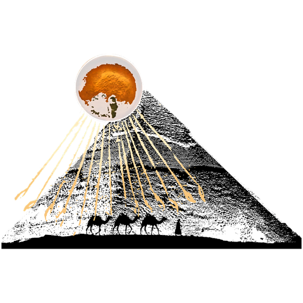

  

# Battery Commander

A menu-bar battery charge limiter for Intel Macs — a fully independent, open
implementation that holds your battery at the charge limit you choose.

## Who it's for

Owners of Intel MacBooks who want a charge limit to slow battery wear. Apple
ships a built-in charge limit only on newer Macs and macOS versions; Intel Macs
never received one. Battery Commander fills that gap on Intel hardware, using
the SMC charge-control mechanism those machines expose.

## Requirements

- An Intel Mac (charge control uses the Intel-era SMC `BCLM` key).
- macOS 10.15 Catalina or later.
- Designed and tested on a MacBook Pro (13-inch, Mid 2012, MacBookPro9,1)
  running macOS 10.15.8. Other Intel models expose the same mechanism but are
  not individually verified.

## Features

- **Charge limit with hold** — set an upper/lower pair (for example 86/85%):
  charging stops at the top and resumes at the bottom. A small root daemon
  enforces the limit by toggling the SMC hold state, and verifies every write
  by read-back.
- **Sailing mode** — optionally let the battery drift between the bounds
  instead of pinning it at the top.
- **Smart Discharge** — drain to a target percentage on demand, including
  **on-AC discharge** (the battery discharges while the charger stays plugged
  in), with supervised sessions and automatic return to the limit afterwards.
- **Calibration support** — guided full-cycle calibration sessions with
  safety floors selected by battery-health band and abort protection.
- **Sleep & power profiles** — curated power profiles from the menu,
  including Power Saver and Stay Awake options.
- **Protection layers** — a temperature/load guard, gauge-jump confirmation
  before any daemon write, overshoot correction, and a verification system
  that scores real hold episodes and reports its own confidence.
- **Native notifications** — posted by the app itself under its own identity;
  no external notifier dependency.
- **Clean quit** — quitting the app fully releases the limit (verified by
  read-back) and returns the Mac to stock behaviour; relaunching resumes
  enforcement.

## Install

1. Download `BatteryCommander-1.0.dmg` from the Releases page.
2. Open the DMG and run **Install Battery Commander**.
3. Battery Commander v1 is **unsigned** (no Apple Developer ID). If
   Gatekeeper blocks the first open, right-click the app, choose **Open**,
   and confirm.

The installer never overwrites an existing installation's state. The daemon
installs to a protected system location (`/Library/PrivilegedHelperTools/`),
not to a user-writable folder.

## Uninstall

Run the included uninstaller. It first releases the charge limit and verifies
the release by read-back; if the release cannot be verified, it removes
nothing and tells you why. Your state folder is kept unless you explicitly
ask to purge it.

## Limitations

- **Unsigned v1** — Gatekeeper warns on first open (see Install above).
- **Intel only** — Apple Silicon Macs use different charge-control keys and
  are not supported by this release.
- **One test-machine class** — developed and verified on a Mid-2012 MacBook
  Pro under Catalina; behaviour on other Intel models or macOS versions may
  differ.
- While the Mac is asleep with the lid closed, the hold state stays as it was
  when sleep began.

## License

See [LICENSE](LICENSE).
